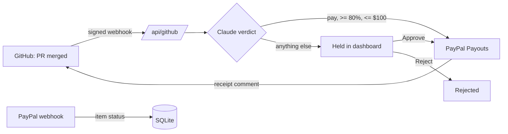

# BountyPay

Open-source maintainers put bounties on issues and then spend their evenings checking PRs and sending money by hand. BountyPay does that settlement for them. Label an issue `bounty:50`, and when a PR that says `Fixes #12` and `PayPal: dev@example.com` is merged, Claude reads the issue and the diff and decides whether the PR really resolves the issue. Inside a mandate written in code (at least 80% confidence, at most $100 per bounty) BountyPay pays the contributor through PayPal Payouts and posts the receipt on the PR. Everything outside the mandate waits in an AG Grid dashboard where a maintainer approves or rejects it. A bounty pays at most once, however many times GitHub redelivers the webhook or a maintainer double-clicks.

## How it works



- One row per bounty issue, so a second PR claiming the same issue cannot be paid. `lib/bounty.ts` holds the lifecycle (`judging`, `held`, `paying`, `sent`, `failed`, `rejected`) and one transition table. Every state change is a compare-and-swap on that row, so the webhook and the dashboard can never both win.
- Claude (`claude-opus-5-5`, structured output) only advises. The pure `decide()` function turns its verdict into pay or hold, and a refusal or an API failure holds.
- The PayPal `sender_batch_id` is derived from the claim. PayPal refuses a reused id and points at the original batch, so a retry after a crash finds the first payout instead of sending a second.

## Quickstart (offline demo mode)

Needs Node 24, a [PayPal sandbox app](https://developer.paypal.com/dashboard/applications/sandbox) and an [Anthropic API key](https://console.anthropic.com/). GitHub is not needed: issues and diffs come from `demo/fixtures.json`, and PR comments are printed in the server log.

```sh
cp .env.example .env.local   # fill in ANTHROPIC_API_KEY, PAYPAL_CLIENT_ID, PAYPAL_CLIENT_SECRET
npm install
npm run dev                  # BOUNTYPAY_DEMO=1 comes from .env.local
npm run demo                 # in a second terminal
```

Open http://localhost:3000. Within a minute you should see:

| Fixture | Expected |
| --- | --- |
| PR #10 fixes issue #1 ($50) | `sent`, approved by Claude, with a PayPal batch id |
| PR #11 only fixes a typo for issue #2 ($40) | `held`, Approve / Reject buttons |
| PR #12 fixes issue #3 ($250) | `held` as `over_cap`, even though Claude says pay |
| PR #13 also claims issue #1 | no change: "already claimed by #10" comment |
| PR #14 has no `PayPal:` line | no row: comment asking for it |
| Replay of PR #10 | no change, still one payout |

Approve a held row to pay it through the same path. To use Postman instead of the script, import `bountypay.postman_collection.json` and send the requests in order. Its pre-request script signs each body with the `webhookSecret` variable.

`npm test` runs the policy, parser, store, and payout-flow tests with fake Claude and PayPal responses.

## On a real repository

1. Deploy (Render: **New > Blueprint** on this repo uses `render.yaml`) and set `BOUNTYPAY_DEMO=0` and `GITHUB_TOKEN`. Render generates `DASHBOARD_TOKEN`; copy it from the service's Environment tab to unlock Approve and Reject.
2. In the repo, add a webhook to `https://<host>/api/github`, content type `application/json`, the `GITHUB_WEBHOOK_SECRET`, and the **Pull requests** event.
3. Label an issue `bounty:50`. Contributors write `Fixes #<issue>` and `PayPal: <email>` in the PR description.
4. Optional: in the PayPal app, add a webhook to `https://<host>/api/paypal` for the `PAYMENT.PAYOUTS-ITEM.*` events and set `PAYPAL_WEBHOOK_ID`. The dashboard's PayPal status column then moves from `pending` to `succeeded`, `unclaimed`, and so on.

## Environment

| Variable | Purpose |
| --- | --- |
| `ANTHROPIC_API_KEY` | Claude judges each merged PR |
| `PAYPAL_CLIENT_ID`, `PAYPAL_CLIENT_SECRET` | PayPal sandbox REST app that sends the payouts |
| `PAYPAL_WEBHOOK_ID` | Verifies payout status webhooks at `/api/paypal` |
| `GITHUB_WEBHOOK_SECRET` | Verifies `X-Hub-Signature-256` on `/api/github` |
| `GITHUB_TOKEN` | Reads issues and diffs, posts comments (not used in demo mode) |
| `BOUNTYPAY_DEMO` | `1` reads `demo/fixtures.json` and logs comments |
| `BOUNTYPAY_DB` | SQLite path, default `./bountypay.db` |
| `DASHBOARD_TOKEN` | When set, Approve and Reject ask for it once per browser |

## PayPal sandbox accounts

Every PayPal developer account comes with a sandbox business account (the sender, already funded) and a sandbox personal account (a receiver) under **Testing Tools > Sandbox Accounts**. Payouts to the fixtures' `@example.com` addresses are created but stay unclaimed. To watch a payout complete, put your sandbox personal account's email in a fixture's `PayPal:` line, then log in to [sandbox.paypal.com](https://www.sandbox.paypal.com) with it to see the money arrive. Sandbox money is not real.

## License

MIT
