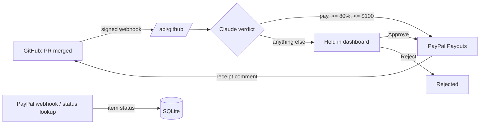

# BountyPay

Open-source maintainers put bounties on issues, then check PRs and send money by hand. BountyPay settles bounties automatically. When a PR that fixes a `bounty:<usd>` issue is merged, Claude checks whether the diff really resolves the issue. If Claude is at least 80% confident and the bounty is $100 or less, BountyPay pays the contributor through **PayPal Payouts** and comments a receipt on the PR. Everything else waits in an **AG Grid** dashboard for a maintainer to approve or reject. A bounty is paid at most once.

## For judges

- **Live demo:** LIVE_URL. It runs on Render's free tier, so the first load after idle takes about 50 seconds.
- **Dashboard token:** in the Devpost testing instructions. You need it to use Approve and Reject.
- **Try it:**
  1. If the dashboard is empty, run `npm run demo -- --url LIVE_URL` from a clone. It posts six signed GitHub merge webhooks.
  2. Within a minute, Claude judges each PR. PR #10 is paid automatically, and its PayPal status turns `succeeded`. PR #11 (typo-only) and PR #12 (over the cap) are held.
  3. Unlock with the token and approve PR #11. Search, filter by state, or export CSV.
- **Real:** Claude (`claude-opus-5-5`) and PayPal sandbox Payouts.
- **Simulated:** GitHub issues and diffs come from `demo/fixtures.json`.

## How it works



- **Claude advises; code decides.** Claude returns pay or hold, a confidence score and its reasoning. The pure `decide()` function in `lib/bounty.ts` applies the 80% and $100 limits. A refusal or an error holds the bounty.
- **Never pays twice.** There is one row per bounty issue, and every state change is a compare-and-swap. The PayPal `sender_batch_id` is derived from the claim, so a retry finds the original payout instead of sending a second one.
- **Truthful status.** Payout status comes from PayPal's webhook, or from a lookup when the dashboard loads. "Paid out" counts only payouts PayPal reports as succeeded.

## Run locally

Needs Node 24, a [PayPal sandbox app](https://developer.paypal.com/dashboard/applications/sandbox) with Payouts enabled, and an [Anthropic API key](https://console.anthropic.com/).

```sh
cp .env.example .env.local   # set ANTHROPIC_API_KEY, PAYPAL_CLIENT_ID, PAYPAL_CLIENT_SECRET
npm install
npm run dev                  # http://localhost:3000
npm run demo                 # second terminal: posts the demo webhooks
npm test                     # 25 tests, fake Claude and PayPal
```

| Demo PR | Expected |
| --- | --- |
| #10 fixes issue #1 ($50) | paid automatically |
| #11 only fixes a typo ($40) | held for review |
| #12 fixes issue #3 ($250) | held, over cap |
| #13 also claims issue #1 | "already claimed" comment |
| #14 has no `PayPal:` line | comment asking for one |
| Replay of #10 | no second payout |

- `npm run demo -- --url <host>` targets a deploy.
- `bountypay.postman_collection.json` sends the same signed requests from Postman. Regenerate it with `node scripts/demo.ts --postman`.

## Use on a real repo

1. Deploy with Render (**New > Blueprint** on this repo uses `render.yaml`). Set `BOUNTYPAY_DEMO=0` and `GITHUB_TOKEN`.
2. Add a repo webhook to `https://<host>/api/github`: content type JSON, secret `GITHUB_WEBHOOK_SECRET`, **Pull requests** event.
3. Label an issue `bounty:50`. Contributors write `Fixes #<n>` and `PayPal: <email>` in the PR description.
4. Optional: add a PayPal app webhook to `https://<host>/api/paypal` for the `PAYMENT.PAYOUTS-ITEM.*` events, and set `PAYPAL_WEBHOOK_ID`.

## Environment

| Variable | Purpose |
| --- | --- |
| `ANTHROPIC_API_KEY` | Claude judges each merged PR |
| `PAYPAL_CLIENT_ID`, `PAYPAL_CLIENT_SECRET` | PayPal sandbox app that sends payouts |
| `PAYPAL_WEBHOOK_ID` | Verifies PayPal webhooks |
| `GITHUB_WEBHOOK_SECRET` | Verifies GitHub webhooks |
| `GITHUB_TOKEN` | Reads issues and diffs, posts comments (not used in demo mode) |
| `BOUNTYPAY_DEMO` | `1` uses `demo/fixtures.json` and logs comments |
| `BOUNTYPAY_DB` | SQLite path, default `./bountypay.db` |
| `DASHBOARD_TOKEN` | Required for Approve and Reject when set |

## Why the sandbox merchant is in the UK

BountyPay was built in Nigeria. PayPal denied every payout from a Nigeria-registered sandbox business account, even a verified one holding USD 5,000. PayPal doesn't offer business accounts or Payouts to Nigerian businesses, so the demo uses UK sandbox accounts. Reaching contributors in send-only markets like Nigeria is BountyPay's next problem to solve.

## License

MIT
